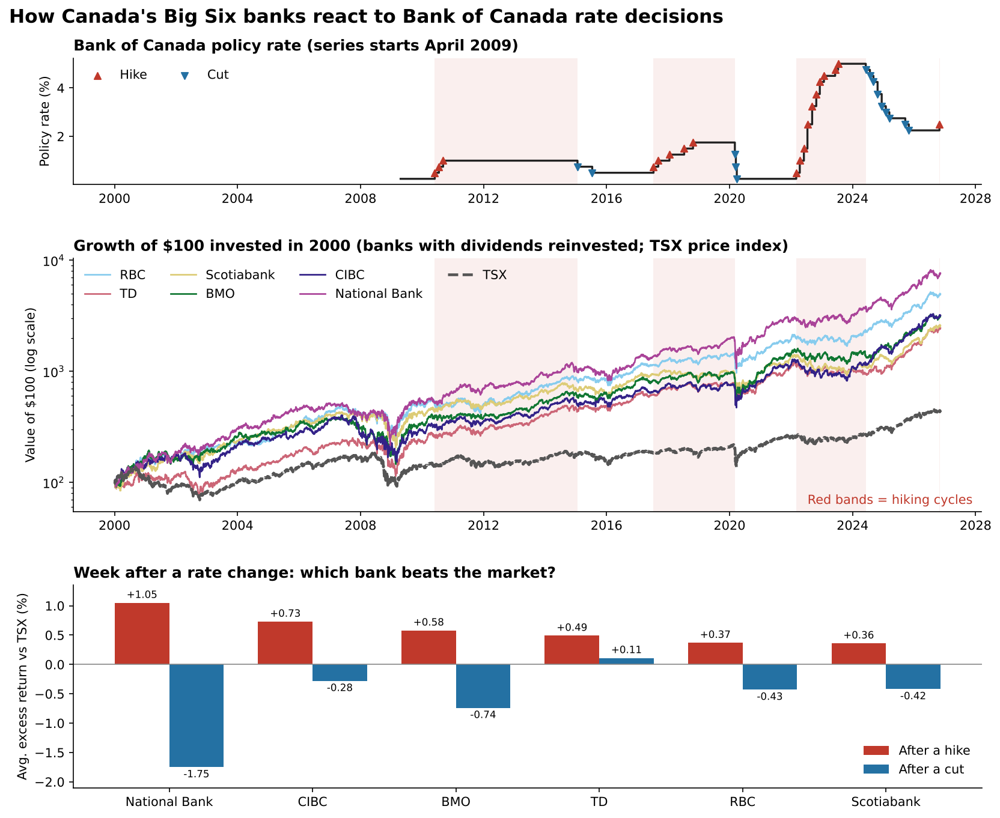

# How Do Canada's Big Six Banks React to Bank of Canada Rate Decisions?

An end-to-end data analysis project combining an official central-bank API, web scraping and market data to measure how Canada's six largest banks respond to interest-rate changes.



Interactive version: download `dashboard.html` and open it in a browser.

## The question
When the Bank of Canada raises or cuts its policy rate, how do RBC, TD, Scotiabank, BMO, CIBC and National Bank shares respond, and which bank is the most rate-sensitive?

The Big Six are a large part of the S&P/TSX Composite and of most Canadian portfolios. Interest rates drive their lending margins, credit losses and valuations, so the answer matters for portfolio allocation and risk management.

## Key findings
Based on 33 Bank of Canada policy-rate changes (19 hikes, 14 cuts) from April 2009, when the Valet policy-rate series starts, to November 2026:

1. **National Bank is the most rate-sensitive of the Big Six.** It beat the TSX by **+1.05%** on average in the week after a hike, but trailed it by **-1.75%** in the week after a cut: a 2.80 percentage-point swing, the largest of the six banks.
2. **After hikes, all six banks held up against the market.** Even the weakest, Scotiabank, still beat the TSX (+0.36%) over the following week.
3. **After cuts, TD was the most defensive** (+0.11% versus the TSX), while National Bank fell furthest behind.
4. **Over whole rate cycles, the best banks clearly beat the TSX.** National Bank returned 14.0% a year during hiking cycles (TSX 4.1%), and CIBC 29.0% a year during cutting cycles (TSX 13.3%). The cutting cycle that started in March 2020 lasted until the first hike in March 2022, so it likely includes the strong post-COVID rebound.
5. **For income investors, Scotiabank paid the highest dividend yield** over the last five full years (5.56% on average).

## Data sources
| Source | Data | Access |
|---|---|---|
| [Bank of Canada Valet API](https://www.bankofcanada.ca/valet/docs) | Policy rate, series `V39079` (Target for the overnight rate) | REST API, JSON, no key |
| [Yahoo Finance](https://finance.yahoo.com) via `yfinance` | Daily prices and dividends for `RY.TO`, `TD.TO`, `BNS.TO`, `BMO.TO`, `CM.TO`, `NA.TO` and the S&P/TSX Composite (`^GSPTSE`) | Python library |
| [Wikipedia: Big Six (banks)](https://en.wikipedia.org/wiki/Big_Six_(banks)) | Context table of the banks | Web scraping |

## Method
1. **Collect.** Pull the full policy-rate history from the Valet API, flag every rate change as a hike or a cut, and label each day by the current rate cycle (direction of the most recent move).
2. **Scrape.** Extract the Big Six table from Wikipedia with BeautifulSoup and `pandas.read_html`.
3. **Market data.** Download adjusted prices (for returns) and actual prices plus dividends (for dividend yield) with `yfinance`.
4. **Event study.** For every rate change, measure each bank's return from the day before to 1 and 5 trading days after, and subtract the TSX return over the same window (excess return).
5. **Cycle analysis.** Use `merge_asof` to attach the rate cycle to each trading day, then compare annualized return and volatility in hiking versus cutting cycles.
6. **Dashboard.** Four interactive Plotly charts, also exported as a standalone `dashboard.html`.

## Skills demonstrated
- REST API requests and JSON parsing (`requests`)
- Web scraping (`BeautifulSoup`, `pandas.read_html`)
- Financial data collection (`yfinance`)
- Data cleaning, reshaping and joining (`pandas`: `merge`, `merge_asof`, `melt`, `groupby`)
- Event-study and return analysis (`numpy`, `pandas`)
- Interactive visualization (`plotly`)

## Repository structure
```
├── canadian_banks_interest_rates.ipynb   # full analysis
├── dashboard.html                        # interactive dashboard (generated)
├── dashboard.png                         # dashboard preview image
└── data/                                 # CSV outputs (generated)
    ├── policy_rate.csv
    ├── rate_decisions.csv
    ├── event_returns.csv
    ├── event_summary.csv
    ├── cycle_summary.csv
    └── dividends.csv
```

## How to run
1. Open the notebook in [Google Colab](https://colab.research.google.com) or Jupyter.
2. If needed, install the libraries: `pip install yfinance plotly lxml beautifulsoup4`
3. Run all cells. Data is downloaded live, so results update each time you run it.

## Limitations
- Correlation, not causation: other news also moves bank shares around decision dates. Excess returns versus the TSX reduce this effect but do not remove it.
- Markets often price in rate decisions in advance, so part of the reaction can happen before the window starts.
- A rate cycle lasts from one move until the next move in the other direction, including long holds.
- Bank returns include reinvested dividends, but the S&P/TSX Composite (`^GSPTSE`) is a price index without dividends. This flatters the banks by roughly their dividend yield (about 4–5% a year) in the cycle comparison, and by much less in the one-week event windows. A total-return index would be a fairer benchmark.

## Next steps
- Add Government of Canada bond yields from the Valet API to separate expected from surprise rate moves.
- Compare with US banks around Federal Reserve decisions.
- Add quarterly earnings (net interest margin) to link rate changes to bank fundamentals.

## Author
Samaneh Kohandani · [GitHub](https://github.com/Samanekohandani) · [LinkedIn](https://www.linkedin.com/in/your-profile) <!-- replace with your LinkedIn link -->
